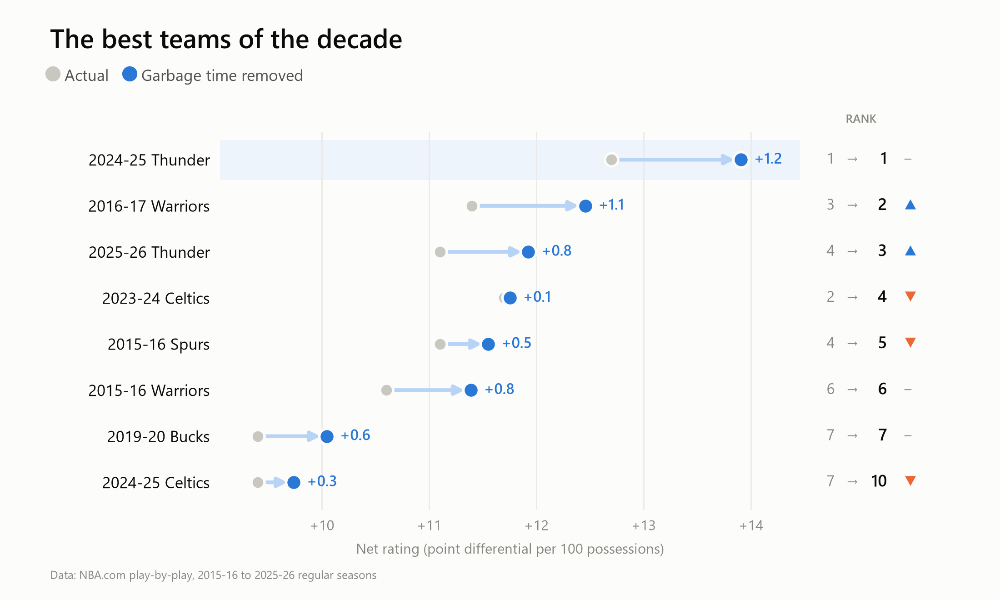

# NBA Mercy Rule

**What if NBA blowouts ended early?** This project replays every
regular-season game from 2015-16 to 2025-26 from NBA.com play-by-play,
stops each one where a tiered fourth-quarter mercy rule would have ended
it, and recalculates every team's offensive, defensive and net rating
without those garbage-time minutes.

The rule (first condition met ends the game):

| Lead | Time left in Q4 |
|---|---|
| 40+ | 8:30 |
| 30+ | 4:30 |
| 25+ | 3:30 |
| 20+ | 3:00 |

## Results

- **3,424 of 13,202 games (25.9%)** would have ended early, and **none**
  would have changed the winner.
- Blowouts are rising: games decided by 20+ points went from 14.2% of
  games in 2015-16 to 22.8% in 2025-26.
- **The #1 net-rating team stays #1 in every season.** No team moves more
  than 4 spots.
- **Good teams get better, bad teams get worse.** The best teams gain
  mostly on offense; the worst teams drop mostly on defense. The 2024-25
  Thunder go from +12.7 to +13.9 net rating; the 2024-25 Wizards from
  −12.2 to −13.4.

Article: https://medium.com/@mounirarayssi/what-if-the-nba-had-a-mercy-rule-7f4c70c32959?sharedUserId=mounirarayssi 



## Setup

Requires Python 3.10+ and internet access to stats.nba.com.

```bash
python -m venv .venv
.venv\Scripts\Activate.ps1          # Windows PowerShell
# source .venv/bin/activate         # macOS / Linux
pip install -r requirements.txt
python -m unittest                  # offline unit tests
```

## Running

```bash
# Quick sample: first 25 games of one season (about a minute)
python main.py --seasons 2025-26 --limit 25

# Everything in config.yaml (11 seasons, ~13,500 games)
python main.py

# Also rank the mercy-adjusted teams against every team since 1996-97
python main.py --historical
```

The first full run downloads about 13,500 play-by-play files at 0.8 s
each, so it takes around 3 hours. Everything is cached in `data/cache/`,
so later runs (e.g. with different rules) take minutes.

| Flag | Meaning |
|---|---|
| `--config FILE` | settings file (default `config.yaml`) |
| `--seasons 2023-24 2024-25` | override the seasons in the config |
| `--limit N` | first N games per season, for testing |
| `--historical` | also build the hybrid all-time leaderboard |

## Article charts

After a full run (plus `--historical`, for NBA.com's official team ratings):

```bash
python make_article_charts.py
```

This writes the charts and tables used in the article to
`output/article_charts/`. Offense and defense are ranked against each
season's league average, because league scoring rose from 105.3 to 114.6
points per 100 possessions over the decade.

## Customizing (`config.yaml`)

**Rules.** A mercy rule is a list of tiers. The game ends the first
moment any tier is satisfied (`|lead| >= min_lead` with
`max_seconds_remaining` or fewer left in one of `periods`, default Q4
only). Once a game has ended, the other tiers no longer matter. Up 40
with 7:00 left ends the game on the `extreme` tier, even if the lead
would have shrunk to 27 with 3:00 left. `trigger_tier` in the output
records which tier ended each game.

```yaml
rules:
  - id: mercy
    name: "Tiered mercy rule"
    tiers:
      - {name: extreme,      min_lead: 40, max_seconds_remaining: 510}
      - {name: aggressive,   min_lead: 30, max_seconds_remaining: 270}
      - {name: moderate,     min_lead: 25, max_seconds_remaining: 210}
      - {name: conservative, min_lead: 20, max_seconds_remaining: 180}
```

If several tiers are satisfied at the same moment, the first one listed is
reported. To compare alternative rules, add more entries under `rules:`.
Each is a separate scenario with its own output folder named after its
`id`, and a rule can also be a single condition (`min_lead` and
`max_seconds_remaining` without `tiers`).

**`analysis.cutoff`** sets where the game stops once a rule triggers:

- `possession` (default): the possession in progress finishes, so nobody
  is left with half a possession. Free throws awarded at the same moment
  (and-ones, technicals) are kept.
- `event`: stops on the exact play-by-play event that met the condition.

**`analysis.possessions`** sets how possessions are counted for ratings:

- `tracked` (default): counted from play-by-play by `src/possessions.py`.
  In sample checks this matched NBA.com's official count exactly for
  78% of team-games in 2025-26 and 88% in 2015-16, and was within 1 for
  nearly all of the rest.
- `estimate`: the box-score formula `FGA − OREB + TOV + 0.44 × FTA`.

Ratings follow NBA.com's definitions:
`ORtg = 100 × points / own possessions`,
`DRtg = 100 × points allowed / opponent possessions`, `Net = ORtg − DRtg`.

## Output (`output/`)

| File | Contents |
|---|---|
| `summary.json` | `publishable` flag, warnings, coverage per season, settings used |
| `scenario_comparison.csv` | one row per season × rule: games cut (and by which tier), comebacks erased, possessions removed, biggest net-rating swings |
| `all_team_ratings.csv` | every team-season × rule: actual vs mercy ORtg / DRtg / Net / pace / eFG% / TS%, ranks, `delta_*`, `rank_gain` |
| `all_games.csv` | every game × rule: triggering tier, time and lead, actual vs mercy score, `comeback_erased` |
| `all_team_game_stats.csv` | per team per game: `actual_*`, `mercy_*`, `removed_*` stats |
| `<rule_id>/` | that rule's games, ratings, erased comebacks and two charts |
| `errors.json` | games that could not be processed (skipped) |
| `validation_issues.csv` | play-by-play totals that don't match the official box score |
| `historical_hybrid_rankings.csv` | only with `--historical` on a publishable run |

**`publishable` is true only when every game of every season was
processed** (no `--limit`, no errors, schedule game count as expected).
Shortened seasons (1998-99, 2011-12, 2019-20, 2020-21) are listed in
`src/config.py:EXPECTED_GAMES`.

## How it works

```
main.py                 runs everything, decides "publishable"
src/config.py           loads and validates config.yaml
src/data.py             NBA API calls, cached to data/cache/
src/core.py             play-by-play -> events -> mercy cutoff -> per-team stats
src/possessions.py      possession tracker (who has the ball, when it changes)
src/analysis.py         box-score validation, season ratings, scenario summary
src/reporting.py        CSV / JSON / charts
check_possessions.py    compares the tracker with NBA.com official possessions
make_article_charts.py  builds the article's charts and tables (output/article_charts/)
tests/                  offline unit tests
```

For each game, `core.parse_game` walks the play-by-play in order (by
`actionId`) and records what every event adds to each team: points (from
scoreboard changes), FGA/FGM/3PA/3PM, FTA/FTM, offensive rebounds, turnovers
and finished possessions. Totalling the events up to the cutoff gives the
mercy-rule game. Totalling all of them gives the real game.

Every game is checked against the official box score. Games whose final
score doesn't match are skipped and listed in `errors.json`. Smaller stat
mismatches are listed in `validation_issues.csv`.

To check the possession tracker on any season:

```bash
python check_possessions.py --season 2018-19 --games 30
```

## Limitations to state when publishing

1. **No behavioral model.** The experiment truncates real games. With an
   actual mercy rule, teams might play differently earlier (e.g. leaders
   pushing to reach the margin).
2. **Possessions are reconstructed** from play-by-play. They are close to
   but not identical with NBA.com's count, usually within one per game.
3. **Regular season only** by default. Overtime is dropped automatically
   when a Q4 rule triggers, because the game is already over.
4. **The historical leaderboard is a hybrid.** Only the experiment seasons
   are mercy-adjusted, and every other team uses its official
   unadjusted rating. Don't call it an all-time mercy-adjusted ranking.
5. **Seven games are excluded.** NBA.com's play-by-play for these games
   has corrupted score rows, so they can't be replayed accurately
   (listed in `output/errors.json`).
6. **Shortened seasons.** 2019-20 (COVID suspension and the bubble) and
   2020-21 (72 games, limited fans) have fewer games and little or no
   home-court advantage. Ratings are per 100 possessions, so they remain
   comparable, but they are noisier.
7. **API access varies.** stats.nba.com sometimes blocks or times out
   requests. Keep the request delay and the cache.


